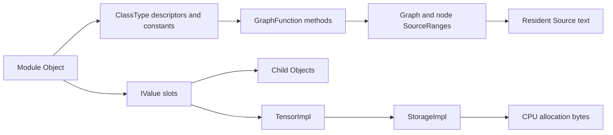

# Findings and interpretation

## What was recovered

The original LiME image contains PID 3183, named `cifar10_inferen`. Volatility
reported 128 VMAs. The model wrapper and input wrapper are in the captured
stack mapping; their Object/TensorImpl targets are in an anonymous mapping.

| Item | Virtual address in this capture |
| --- | --- |
| Model wrapper | `0xffffffffe588` |
| Model Object | `0xaaaaae062af0` |
| Input wrapper | `0xffffffffe4a8` |
| Input TensorImpl | `0xaaaaadfce280` |

Volshell confirmed the same model/input pointers recorded in GDB. The input
rank is four, shape `[128, 3, 32, 32]`, and element count 393,216.

The extractor recovered 26 module objects: the root, two containers, and 23
leaf modules. The 31 tensors consist of 22 parameters and nine batch-normalization
buffers. Their raw contents total 3,260,096 bytes.

All 31 tensors matched the reference in bytes, shape, dtype, and name. Module
names, types, and registration order matched. All 19 archived TorchScript `.py`
source files were recovered byte-for-byte, with 34 materialized function graphs.
See [validation.json](../evidence/recovery/validation.json).

## From bytes to model objects

The kernel ISF describes Linux structures used to find the process and translate
its addresses. The separate PyTorch ABI profile describes C++ field offsets used
inside that process. They serve different purposes.

## Behavior after reconstruction

The replay helper instantiated recovered classes and assigned recovered settings
and tensors. It used the captured function bodies, with annotation/cast erasure
and explicit intrinsic adapters for the installed CPU runtime. The original
TorchScript archive was loaded only after reconstruction for output comparison.

The full 6,000-image test set produced 6,000 matching predicted labels and exactly
matching logits. Both implementations were correct on 5,225 images, or 87.0833%.
This demonstrates equality on the selected test set, not correctness on every
possible input.

The first evaluation batch exercised 31 distinct recovered functions. The
three recovered but unused definitions were the two Sequential `__len__` methods
and the training-only `_verify_batch_size` helper. The observed layer forward
order matched the recovered tree for this model.

## Scope

- Recovery needs the captured PID and root Object pointer from GDB. Automatic
  discovery of unknown models is not implemented.
- The profile is for the measured 64-bit little-endian GNU C++ target. Other
  versions, compilers, and architectures may need a new profile and decoder work.
- The demonstrated tensors are CPU, contiguous float32/int64 state. GPU VRAM,
  sparse/quantized tensors, and arbitrary Python object recovery are unsupported.
- Recovered code is generated TorchScript source. The original training script
  and native C++ kernel source are not reconstructed.
- Graph records preserve topology/source relationships but are not a complete
  TorchScript IR serializer. Source files provided the executable model logic.
- Replay is through a Python compatibility layer. It is not a newly exported
  standalone TorchScript archive; `recovered_state_dict.pt` contains state only.
- Function tracing describes the first evaluation batch, not every branch or
  every native runtime call.
- The optional GDB core inspection lacked a heap page. The successful recovery
  used the LiME image. Full-system acquisition completeness beyond the recovered
  target pages has not been independently certified.

## Remaining assignment checks

The walkthrough includes the three preserved original screenshots. Additional
training/build, extraction, validation, and replay screenshots would strengthen
the final submission. The assignment's textbook reading remains a personal
prerequisite. Its "most recent PyTorch" wording needs a release-date check; this
repository records installed versions and does not upgrade or retrain to change
that historical record.

If the instructor intends native machine-code extraction or a full native call
trace under "any code called during forward," that is additional work. The
current evidence establishes recovered TorchScript implementation and tested
evaluation behavior.
