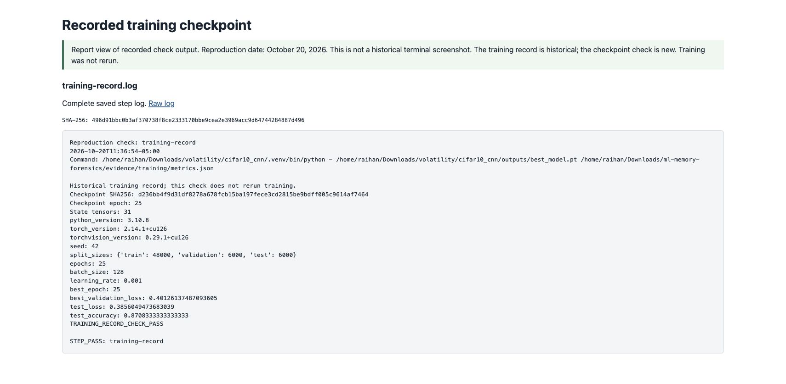
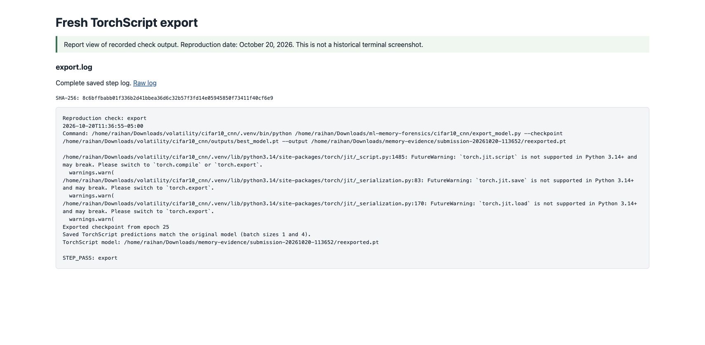
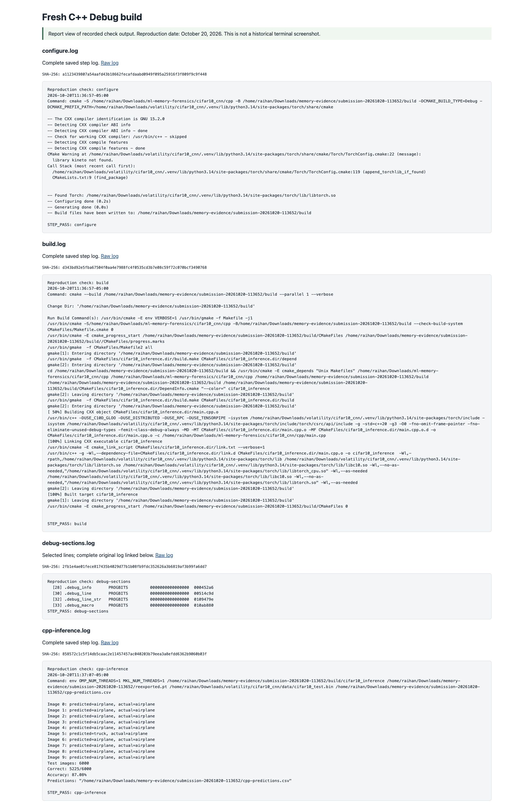
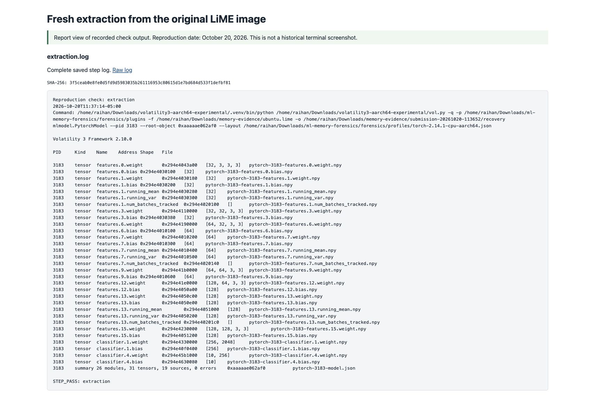
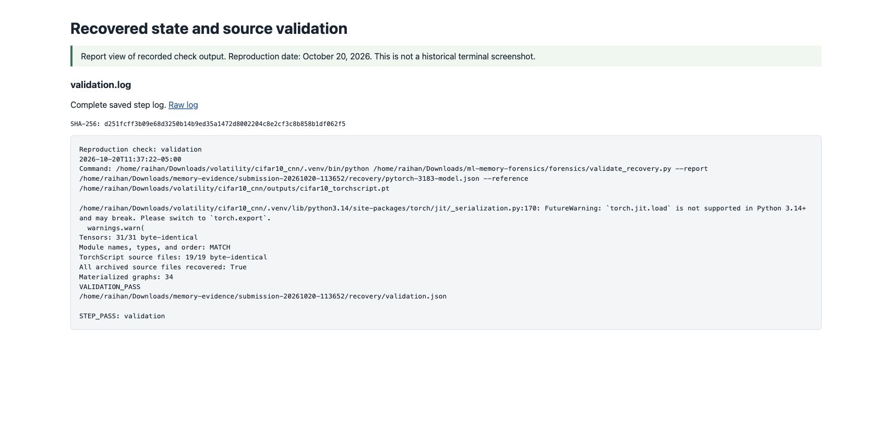
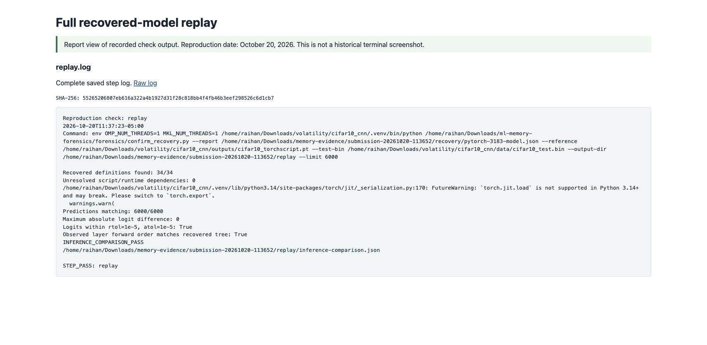
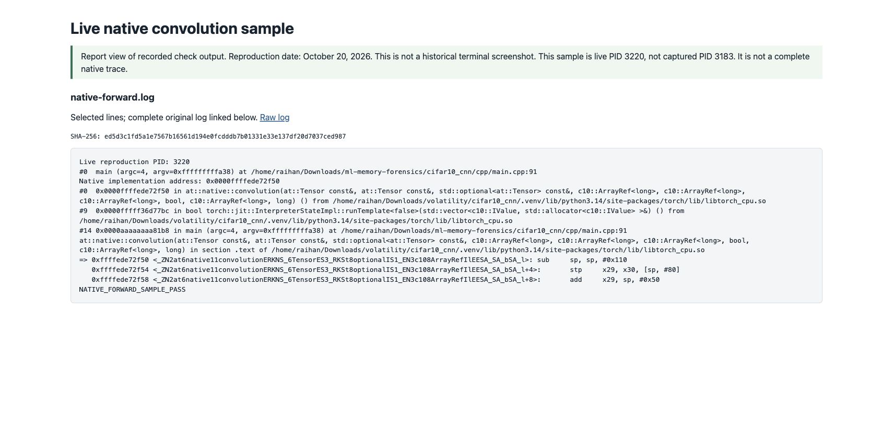

# Submission evidence supplement: October 20, 2026

The original experiment's capture and reports are preserved. This supplement
adds a fresh export/build/inference check and repeats extraction, validation,
and recovered-model replay against the original memory image. It also records
one native convolution call in a new live process.

The [summary](../evidence/submission-2026-10-20/summary.json) verifies all eleven
check stages. Reproduction binaries and tensors remain outside Git at
`/home/raihan/Downloads/memory-evidence/submission-20261020-113652/`; their
[artifact hashes](../evidence/submission-2026-10-20/artifacts.json) are recorded.

## How the screenshots were collected

Three original GDB/PID/Volshell screenshots remain unchanged. The eight new
images consist of one official release-page screenshot and seven screenshots
of clearly labeled browser reports displaying saved check logs. These are
actual browser captures. They are not reconstructions of historical terminals.
The raw log links and SHA-256 values make the report views auditable.

The training check reads the saved epoch-25 checkpoint and historical metrics.
Training was not rerun. The other check stages executed on October 20. The
capture still contains PID **3183**; the added native sample is live PID **3220**.

## 1. Check the recorded training and release

The checkpoint contains 31 state tensors and reports epoch 25. Historical
metrics record 48,000 training / 6,000 validation / 6,000 test examples and
87.0833% test accuracy. [Training check log](../evidence/submission-2026-10-20/training-record.log).



The [release verification](VERSION_VERIFICATION.md) establishes that recorded
PyTorch 2.14.1 matches the latest stable release as of the October 17 artifact
commit. Git dates establish a repository record, not the exact job start/end.
If precise timing is requested, preserve the original Argon job stdout and
scheduler record alongside that commit.

## 2. Export a new TorchScript archive

The exporter reads the preserved checkpoint, writes a separate `.pt` archive,
reloads it, and compares outputs with the checkpoint-built model for batch
sizes 1 and 4. The original reference archive is not overwritten.
[Export log](../evidence/submission-2026-10-20/export.log).



The installed Python 3.14 runtime emits TorchScript compatibility warnings.
They remain visible in the logs. The measured export and inference completed;
these results do not establish general support for every Python 3.14 use case.

## 3. Build and run C++ with debugging information

A separate build directory was configured with `CMAKE_BUILD_TYPE=Debug`. The
compiler command includes `-g3`, `-O0`, `-fno-omit-frame-pointer`,
`-fno-eliminate-unused-debug-types`, and `-femit-class-debug-always`. `readelf`
confirms `.debug_info`, `.debug_line`, and `.debug_macro` sections.

C++ inference on the newly exported archive read all 6,000 test images and
made 5,225 correct predictions, reproducing 87.08% printed accuracy.
[Build log](../evidence/submission-2026-10-20/build.log),
[debug sections](../evidence/submission-2026-10-20/debug-sections.log),
[inference log](../evidence/submission-2026-10-20/cpp-inference.log).



## 4. Extract again from the preserved image

The external `mlmodel.PytorchModel` plugin used the original capture PID and
root address with the measured PyTorch profile. It recovered 26 module objects,
31 tensors, and 19 source files with zero reported errors.
[Extraction log](../evidence/submission-2026-10-20/extraction.log).



## 5. Validate the recovered state and source

The validator compared the new recovery with the original reference archive.
All 31 tensors and 19 source files matched byte-for-byte. Module names, types,
and order matched; 34 materialized graphs were recorded.
[Validation log](../evidence/submission-2026-10-20/validation.log),
[structured results](../evidence/submission-2026-10-20/recovery/validation.json).



## 6. Replay the full test set

The replay helper constructed the model from recovered code, settings, and
tensors before loading the reference for comparison. All 6,000 predictions
matched, maximum absolute logit difference was zero, and the observed first-batch
layer order matched the recovered tree.
[Replay log](../evidence/submission-2026-10-20/replay.log),
[structured comparison](../evidence/submission-2026-10-20/replay/inference-comparison.json).



## 7. Inspect a native forward-pass boundary

The final GDB sample stopped at `main.cpp:91`, then at the actual native
convolution implementation in `libtorch_cpu.so`. It recorded the interpreter
and dispatcher stack and twelve ARM64 instructions from the `.text` function
entry. The screenshot shows selected frames and the first three instructions;
the complete sample is in the [raw native log](../evidence/submission-2026-10-20/native-forward.log).



The initial wrapper-breakpoint attempt and PLT-only sample are preserved with
explicit filenames. The successful sample locates the non-PLT symbol in the
current process rather than hardcoding an address from another execution.
This is one live native sample, not an exhaustive trace or native-code recovery
from the original capture. The [scope document](CODE_SCOPE.md) provides the
remaining instructor question.

## Repeat these checks

Use the existing Ubuntu environments and restored private artifacts described
in [REPRODUCE.md](REPRODUCE.md), then run:

```bash
cd "$HOME/Downloads/ml-memory-forensics"
bash scripts/collect_submission_evidence.sh
```

The script uses a new timestamped directory and builds with one compiler job.
It requires the matching CPU `torchvision` package and Pillow for the existing
exporter's training-module import. This reproduction installed torchvision
0.29.1+cpu and Pillow into the existing CIFAR venv; PyTorch stayed at 2.14.1+cpu.
Each step saves its command, timestamp, output, and success marker. The summary
checks markers and results and records hashes for generated binary artifacts.

To display logs as report pages, using the directory created by the script:

```bash
python3 scripts/build_evidence_pages.py \
  --logs /path/to/submission-run --output-dir /tmp/submission-reports
python3 -m http.server 8766 --bind 127.0.0.1 --directory /tmp/submission-reports
```

Open `http://127.0.0.1:8766/` and capture the reports in a browser. Keep their
labels and raw logs. If the instructor specifically requires terminal screenshots,
run the same commands in a visible terminal and capture that session instead.
