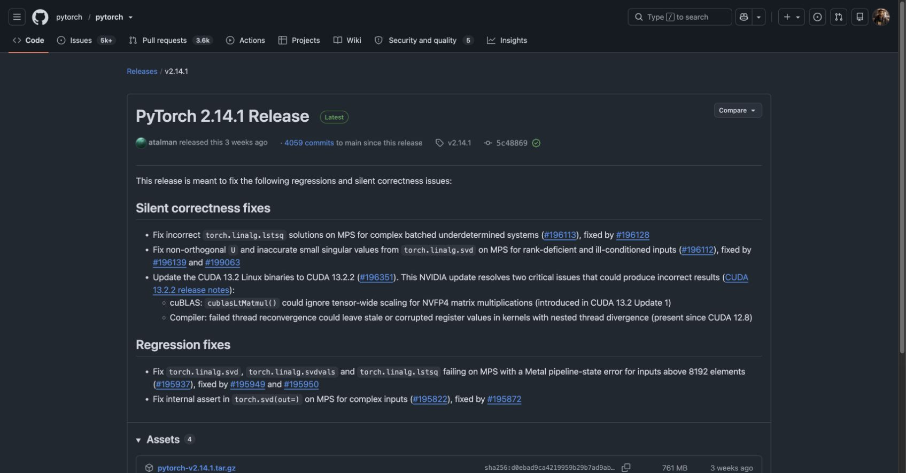

# PyTorch version verification

Checked October 20, 2026 against the official PyTorch release history and PyPI.

The original repository contains commit
[`280a385a8722a449d013c70e2a20175575eb4809`](https://github.com/hridoy100/volatility/commit/280a385a8722a449d013c70e2a20175575eb4809),
dated October 17, 2026 at 11:50:14 -05:00, with subject `after training`.
It introduced the recorded checkpoint and metrics. Those metrics record
Python 3.10.8, PyTorch 2.14.1+cu126, 25 epochs, and the 48,000/6,000/6,000 split.

The [official v2.14.1 release](https://github.com/pytorch/pytorch/releases/tag/v2.14.1)
was published September 30, 2026 at 19:14:48 UTC. It is the highest stable
release in the retrieved GitHub release history by the October 17 evidence date,
and remains the latest stable release at this check. The
[PyPI metadata](https://pypi.org/pypi/torch/json) also reports version 2.14.1;
its first 2.14.1 upload is September 30, 2026 at 17:43:48.426734 UTC.
The `+cu126` suffix records the CUDA build variant rather than a different
upstream release number. The CPU capture environment reports 2.14.1+cpu and
commit `5c4886908584029761b579af026dcfb627c84070`, matching the official release tag.

The recorded training version therefore matches the latest stable release
available as of the repository's dated training-artifact record. Python 3.10.8
also satisfies the assignment's Python >3.9 requirement.

Git dates are evidence of the repository record, not independently authenticated
scheduler timestamps. The exact training start/finish is not stored in these
metrics. If exact timing is required, obtain the Argon job stdout and scheduler
start/end record. No retraining or replacement of historical artifacts was
performed to make this comparison.

Evidence:

- [Structured release comparison](../evidence/release-history/pytorch-release-check.json)
- [Official latest-release metadata snapshot](../evidence/release-history/latest-release.json)
- [Training commit metadata](../evidence/release-history/training-commit.txt)
- [Recorded training metrics](../evidence/training/metrics.json)
- [Official release screenshot](images/04-pytorch-release.jpg)

