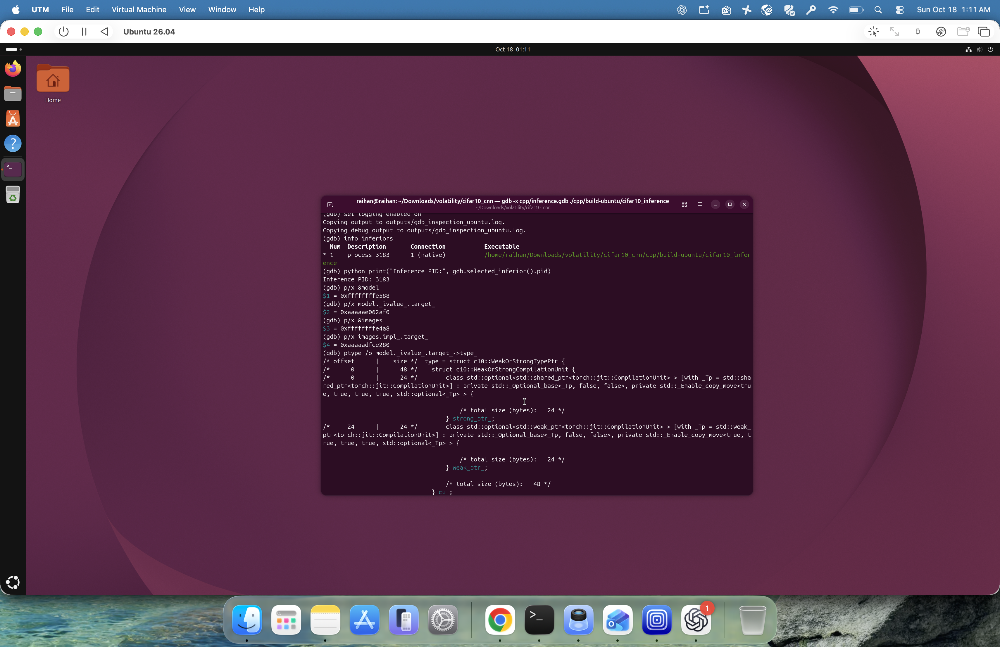
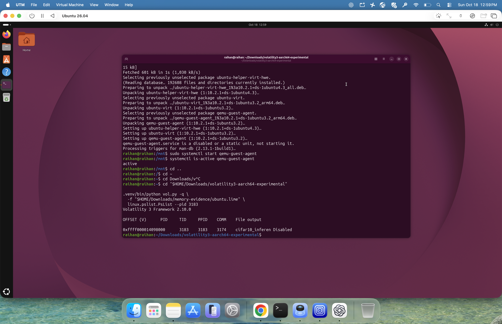
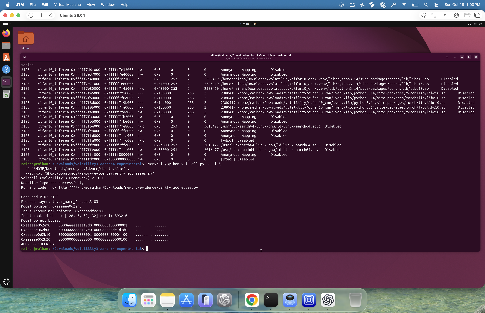

# Recovering a CIFAR-10 model from Linux memory

I wanted to recover the state and implementation of a deployed model from RAM,
then check whether the recovered artifacts could reproduce its behavior. I used
a model I trained myself so that I could validate the forensic results against
a known reference.

The experiment moved through three environments: Argon for GPU training, an
Apptainer environment for the earlier C++/GDB work, and an Ubuntu ARM64 VM for
privileged memory capture and the final recovery. The trained model transferred
between environments; the native executable and structure layouts were matched
to each target.

The recorded result is a recovery of 31 tensors, 26 module objects, 19 generated
TorchScript source files, and 34 function graphs. A reconstructed implementation
agreed with the original on all 6,000 test-image predictions and output logits.

## 1. Train a custom model

The network in [train.py](../cifar10_cnn/train.py) uses six 3×3 convolutions,
batch normalization, ReLU activations, and three pooling stages. The classifier
flattens the resulting 128×4×4 features, applies a 256-unit linear layer and
dropout, and returns ten class logits. No pretrained network is used.

To meet the requested split, I pooled CIFAR-10's original 50,000-image training
set and 10,000-image test set, then made a disjoint stratified split with seed 42:

| Partition | Images | Images per class |
| --- | ---: | ---: |
| Training | 48,000 | 4,800 |
| Validation | 6,000 | 600 |
| Testing | 6,000 | 600 |

Random crop and horizontal flip apply only to training images. Input pixels are
normalized with `(pixel / 255.0 - 0.5) / 0.5`. This is a custom split, so its
accuracy should not be compared directly with the official 10,000-image test
benchmark.

In an allocated Argon GPU environment, from `cifar10_cnn`:

```bash
python -u train.py --epochs 25 --output-dir outputs
```

The run used Python 3.10.8, PyTorch 2.14.1+cu126, batch size 128, and learning
rate 0.001. The best validation epoch was 25. Final accuracy was 5,225/6,000,
or 87.0833%, as recorded in [metrics.json](../evidence/training/metrics.json).
The installed versions are preserved; verifying the assignment's historical
[release comparison](VERSION_VERIFICATION.md) checks the recorded version against
the dated October 17 training-artifact commit.

## 2. Export the trained checkpoint

The training checkpoint saves state and metadata. I exported a separate
TorchScript archive using [export_model.py](../cifar10_cnn/export_model.py):

```bash
python export_model.py \
  --checkpoint outputs/best_model.pt \
  --output outputs/cifar10_torchscript.pt
```

The exporter loads weights on CPU, sets evaluation mode, uses `torch.jit.script`,
saves the archive, and checks the reloaded model against the Python model.
The archive contains generated model code, weights, and class labels for LibTorch.
This follows the assignment's explicit
[TorchScript C++ export workflow](https://docs.pytorch.org/tutorials/advanced/cpp_export.html).

The saved checkpoint, exported model, and recovered state dictionary all use
`.pt`, but they are different artifacts. Hashes and storage locations are in the
[external artifact manifest](../manifests/artifacts.json).

## 3. Run inference in C++ with debug information

[prepare_test_images.py](../cifar10_cnn/prepare_test_images.py) writes the exact
held-out records selected by the checkpoint. Each record is one class-label byte
followed by 3,072 planar RGB bytes. It checks for overlap with training/validation
indices before writing the test binary.

```bash
python prepare_test_images.py --checkpoint outputs/best_model.pt

cmake -S cpp -B cpp/build-ubuntu -DCMAKE_BUILD_TYPE=Debug \
  -DCMAKE_PREFIX_PATH="$(python -c 'import torch; print(torch.utils.cmake_prefix_path)')"
cmake --build cpp/build-ubuntu --parallel 2

./cpp/build-ubuntu/cifar10_inference \
  outputs/cifar10_torchscript.pt data/cifar10_test.bin outputs/cpp_predictions.csv
```

The [C++ program](../cifar10_cnn/cpp/main.cpp) uses `torch::jit::load`, applies the
same normalization, runs batches of 128, and writes predictions. It explicitly
uses CPU inference, making its tensor allocations available in system RAM.

The [CMake configuration](../cifar10_cnn/cpp/CMakeLists.txt) uses C++20 and retains
full debugging information. GNU/Clang flags include `-g3`, `-O0`, and
`-fno-omit-frame-pointer`, together with type-retention options. Retaining complete
header-defined class types mattered because the prebuilt library did not provide
all the debug types needed for inspection.

Earlier Argon attempts encountered compiler/runtime and CUDA compatibility
problems. The [historical Argon notes](../cifar10_cnn/ARGON.md) preserve the
Apptainer route. The final Ubuntu forensic target was rebuilt natively for ARM64;
an x86 executable is not interchangeable with an ARM64 executable.

## 4. Stop at the forward pass in GDB

The forward call is at line 91 of the preserved `main.cpp`:

```cpp
auto logits = model.forward({images}).toTensor();
```

From `cifar10_cnn`, the supplied script sets the arguments, breakpoint, logging,
and read-only inspection commands:

```bash
gdb -x cpp/inspect_model.gdb ./cpp/build-ubuntu/cifar10_inference
```

Stopping before forward leaves the loaded model and input batch in memory.
Keep the inferior stopped while capturing memory from another terminal. A new
run gets a new PID and usually different addresses; the recorded values below
belong only to the original capture.

## 5. Record PID and inspect PyTorch structures

The captured Ubuntu process was PID **3183**. GDB reported:

| Object | Captured address |
| --- | --- |
| Model wrapper | `0xffffffffe588` |
| `model._ivalue_.target_` | `0xaaaaae062af0` |
| Input tensor wrapper | `0xffffffffe4a8` |
| Input TensorImpl | `0xaaaaadfce280` |



The Object's ClassType describes named attributes, parameter/buffer kinds, layer
constants, and methods. Object IValue slots hold the corresponding values.
Object-valued slots lead to child modules; tensor-valued slots lead to TensorImpl,
StorageImpl, and the allocation holding the values.

The target package reported PyTorch 2.14.1+cpu and source revision
`5c4886908584029761b579af026dcfb627c84070`. I measured field paths and offsets
from the executable's retained DWARF types and matching installed headers, rather
than borrowing offsets from a different build. The
[ABI profile](../forensics/profiles/torch-2.14.1-cpu-aarch64.json) records those
measurements and the executable hash. The corresponding build-reported revision
is referenced in [PyTorch GitHub](https://github.com/pytorch/pytorch/tree/5c4886908584029761b579af026dcfb627c84070);
the installed headers and debug types are the direct evidence for the layout.

The [GDB helper](../cifar10_cnn/cpp/torch_inspect.py) provides `torch-slots`,
`torch-attr`, and `torch-tensor`. It reads memory and types without invoking
functions in the stopped inferior. The inspection script follows the first
convolution's weight tensor through storage and displays floats and hexadecimal
words.

## 6. Capture RAM and identify the process offline

LiME was built against the running Ubuntu kernel. For a new acquisition in an
authorized VM, build the module, create a private output directory, and load it
while the inference process remains stopped:

```bash
make -C "$HOME/Downloads/LiME/src"
mkdir -p "$HOME/Downloads/memory-evidence"

sudo insmod "$HOME/Downloads/LiME/src/lime-$(uname -r).ko" \
  "path=$HOME/Downloads/memory-evidence/new-capture.lime format=lime"
```

Do not overwrite the original image. The original acquisition reported an
`Invalid parameters` insertion error, but left a LiME-format file. Its header
was checked, the file was hashed, and the target process pages were successfully
analyzed. This is evidence that the target artifacts were present; it does not
independently certify completeness of every system page.

The retained image is 4,289,855,648 bytes with SHA-256:

```text
17444d6e2daa1089feb8e1c7c1d01e5effb4c8500f60c4455102d0af4d57a769
```

The exact kernel debug ELF was needed to build the Volatility kernel ISF. Symbol
conversion exceeded the VM's available RAM, so I transferred the ELF through the
QEMU guest agent and generated the ISF on the Mac. The ISF was copied back and its
kernel banner matched the capture. The kernel ELF/ISF and memory image stay out
of Git.

The existing ARM64 translation support came from an experimental Volatility 3
branch. Two plugin requirements were patched to allow AArch64 for PsList and
Maps. See [the patch](../patches/arm64-process-plugins.patch) and the exact
[reproduction commands](REPRODUCE.md).

PsList found PID 3183 with parent PID 3174. Maps produced 128 VMAs:



The [PID table](../evidence/capture/pslist-3183.tsv) and
[VMA table](../evidence/capture/maps-3183.tsv) preserve the complete results.

## 7. Check the recorded addresses with Volshell

Volshell switched to the captured process layer and read its virtual addresses.
The wrapper pointers matched GDB. The input TensorImpl reported rank four,
shape `[128, 3, 32, 32]`, and 393,216 elements.



The verification script is [verify_addresses.py](../forensics/verify_addresses.py).
It reads real pages without padding missing data and ends with
`ADDRESS_CHECK_PASS`. The Object and TensorImpl targets were inside the anonymous
mapping `0xaaaaaac00000–0xaaaaae200000`; their wrappers were on the stack.

An optional GDB core-file attempt lacked a heap page. Its
[failure log](../evidence/logs/gdb-core-inspection.log) is preserved. The successful
checks used the original LiME image.

## 8. Recover and execute the model

The [custom plugin](../forensics/plugins/mlmodel.py) locates the task,
constructs a process layer, and starts at the supplied root Object pointer.
It pairs ClassType descriptors with IValue slots, walks child modules, and
extracts tensor allocations after checking shape, dtype, strides, storage offset,
and allocation bounds. Parameters and batch-normalization buffers are retained.

GraphFunction methods and the CompilationUnit lead to graphs and SourceRanges.
Resident Source objects hold string-view pieces containing generated TorchScript
code. The plugin joins those pieces and saves their actual bytes and provenance.
It also records graph topology and source relationships.

The plugin does not open the checkpoint or import the original model definition.
The separately run validator compares recovered artifacts with the reference.
Its [report](../evidence/recovery/validation.json) confirms 31/31 tensors and
19/19 archived `.py` files are byte-identical, with matching module names, types,
and registration order. There are 26 module objects and 34 function graphs.

I then used [confirm_recovery.py](../forensics/confirm_recovery.py) to instantiate
the captured hierarchy and assign its recovered settings and tensor values. The
captured function bodies were compiled as Python after annotation/cast erasure,
with explicit adapters to the installed CPU runtime. The original archive was
opened only after reconstruction for comparison.

The [full comparison](../evidence/replay/inference-comparison.json) records:

```text
Recovered definitions found: 34/34
Unresolved script/runtime dependencies: 0
Predictions matching: 6000/6000
Maximum absolute logit difference: 0
Observed layer forward order matches recovered tree: True
INFERENCE_COMPARISON_PASS
```

Matching predictions means agreement between implementations. Both were correct
on 5,225 images, or 87.0833%. Thirty-one distinct recovered functions ran in the
first evaluation batch; the remaining definitions were two `__len__` methods and
the training-only `_verify_batch_size` helper.

The [code map](../evidence/replay/code-coverage.json),
[predictions](../evidence/replay/predictions.csv), and original
[replay log](../evidence/logs/replay-confirmation-6000.log) are tracked here.
The ten decoder tests and five replay tests cover bounds, missing pages, storage
offsets, unsupported layouts, source integrity, and missing definitions.

## Interpretation and remaining evidence

The experiment established guided recovery of this model's weights, hierarchy,
and archived TorchScript implementation, followed by identical evaluation outputs
on the held-out dataset. The [findings](FINDINGS.md) explain the supported layout,
CPU-only scope, and distinction between generated source and native C++ kernels.

The write-up preserves three original screenshots and adds eight new browser
screenshots in the [submission supplement](SUBMISSION_EVIDENCE.md). The new log
report views are labeled as October 20 reproduction evidence. They do not
recreate historical terminal sessions. See the [version check](VERSION_VERIFICATION.md)
and [code scope](CODE_SCOPE.md) for the remaining timestamp and coverage limits.

The related [AI Psychiatry work](https://www.usenix.org/conference/usenixsecurity24/presentation/oygenblik)
studies recovery and rehosting of deployed models from memory. The
[ZEN paper](https://www.ndss-symposium.org/wp-content/uploads/2026-s1628-paper.pdf)
emphasizes recovering programmatic implementations alongside mathematical model
representations. This project uses a controlled, GDB-guided TorchScript target;
it does not reproduce those systems' full discovery, attribution, GPU recovery,
or model-patching techniques.
