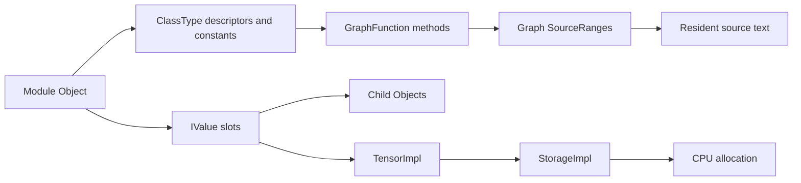

# Findings

The experiment tested whether a deployed CNN could be reconstructed from RAM
well enough to reproduce its inference results. A known model provided a
reference for checking every recovered tensor, source file, and prediction.

## Model state and implementation

The original image contains PID 3183, `cifar10_inferen`, with 128 VMAs. GDB and
Volshell reported the same pointers:

| Object | Virtual address |
| --- | --- |
| Model wrapper | `0xffffffffe588` |
| Model Object | `0xaaaaae062af0` |
| Input wrapper | `0xffffffffe4a8` |
| Input TensorImpl | `0xaaaaadfce280` |

The wrappers are on the stack; their targets are in an anonymous mapping. The
input has shape `[128, 3, 32, 32]` and 393,216 elements. These addresses belong
to this capture and should not be reused for a newly launched process.

The extractor recovered 26 module objects: the root, two containers, and 23
leaf modules. The 31 tensors contain 22 parameters and nine batch-normalization
buffers, totaling 3,260,096 raw bytes. All tensors matched the reference in name,
shape, dtype, and contents. Module names, types, and registration order also
matched. All 19 archived TorchScript `.py` files were recovered byte for byte,
along with 34 materialized function graphs.

The [validation report](../evidence/recovery/validation.json) records these checks.

Linux symbols provide the task and address-translation structures. The separate
PyTorch profile provides application field offsets. Both are needed to follow
this object chain correctly.

## Reconstructed inference

The replay helper builds the captured hierarchy, assigns recovered tensors and
settings, and executes the recovered function bodies. It removes TorchScript
annotations/casts and supplies adapters for the runtime operations used here.
The reference archive is loaded afterward for comparison.

On all 6,000 held-out images, predicted labels and output logits matched exactly.
Both implementations classified 5,225 images correctly: 87.0833% accuracy.
The first batch exercised 31 recovered functions. The unused definitions were
two Sequential `__len__` methods and the training-only `_verify_batch_size` helper.
Observed layer order matched the recovered tree.

See the [inference comparison](../evidence/replay/inference-comparison.json) and
[function inventory](../evidence/replay/code-coverage.json).

## Native code

The original pre-forward capture passed the ELF identity checks but could not
read the selected convolution code range. A separate capture after one completed
batch recovered the full 584-byte function.

A later live trace recorded 40 entry hits across 10 of 12 candidate functions.
All ten selected bodies were recovered from the warm image: 23,340 bytes, each
matching the reference library. These include nested convolution and
batch-normalization calls, ReLU, pooling, linear, and flatten. They are not 40
independent model layers.

The [native recovery guide](native-code-recovery.md) records the method and
[reports](../evidence/native-trace-2026-10-20/README.md).

## Limits

- Recovery requires the captured PID and root Object pointer. Automatic discovery
  of unknown models is not implemented.
- The ABI profile is specific to the measured GNU C++ ARM64 build. Other builds
  may need different offsets and decoder changes.
- GPU VRAM, sparse/quantized tensors, and arbitrary Python objects are outside
  the demonstrated recovery.
- Recovered model code is generated TorchScript source. The original training
  script and original native C++ source are not reconstructed.
- The graph records are not a complete TorchScript IR serializer. Replay uses
  a Python compatibility layer; `recovered_state_dict.pt` holds state only.
- Matching outputs establish agreement on this test set, not all possible inputs
  or branches.
- Native extraction covers selected symbol-bounded bodies. Internal/indirect
  callees, inline code, backend libraries, and runtime calls are not exhaustively
  traced. Function-body bytes can include padding and unexecuted blocks.
- Missing pages are reported without padding or disk fallback. An unreadable
  process mapping does not prove that the bytes are absent everywhere in RAM.
- Successful target recovery and valid LiME range framing do not certify an
  atomic or complete acquisition of every system page.
