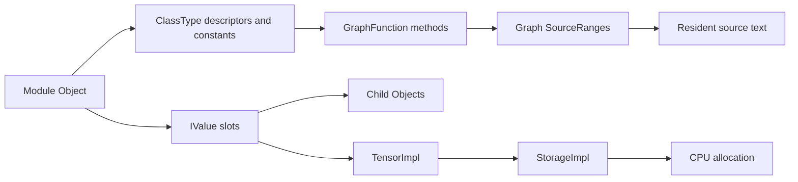

# Findings

The experiment tested whether a deployed CNN could be reconstructed from RAM
well enough to reproduce its inference results. A known model provided a
reference for checking every recovered tensor, source file, and prediction.

## Model state and implementation

The original image contains PID 3183, `cifar10_inferen`, with 128 VMAs. GDB and
Volshell reported the same pointers:

| Object | Virtual address |
| --- | --- |
| Model wrapper | `0xffffffffe588` |
| Model Object | `0xaaaaae062af0` |
| Input wrapper | `0xffffffffe4a8` |
| Input TensorImpl | `0xaaaaadfce280` |

The wrappers are on the stack; their targets are in an anonymous mapping. The
input has shape `[128, 3, 32, 32]` and 393,216 elements. These addresses belong
to this capture and should not be reused for a newly launched process.

The extractor recovered 26 module objects: the root, two containers, and 23
leaf modules. The 31 tensors contain 22 parameters and nine batch-normalization
buffers, totaling 3,260,096 raw bytes. All tensors matched the reference in name,
shape, dtype, and contents. Module names, types, and registration order also
matched. All 19 archived TorchScript `.py` files were recovered byte for byte,
along with 34 materialized function graphs.

The [validation report](../evidence/recovery/validation.json) records these checks.

Linux symbols provide the task and address-translation structures. The separate
PyTorch profile provides application field offsets. Both are needed to follow
this object chain correctly.

## Reconstructed inference

The replay helper builds the captured hierarchy, assigns recovered tensors and
settings, and executes the recovered function bodies. It removes TorchScript
annotations/casts and supplies adapters for the runtime operations used here.
The reference archive is loaded afterward for comparison.

On all 6,000 held-out images, predicted labels and output logits matched exactly.
Both implementations classified 5,225 images correctly: 87.0833% accuracy.
The first batch of the recovered-source Python replay exercised 31 distinct
recovered functions in 49 calls. This trace is not from the original C++ process.
The unused definitions were two Sequential `__len__` methods and the
training-only `_verify_batch_size` helper.
Observed layer order matched the recovered tree.

See the [inference comparison](../evidence/replay/inference-comparison.json) and
[function inventory](../evidence/replay/code-coverage.json).

## Forward-pass implementation coverage

The [extractor](../forensics/plugins/mlmodel.py) follows materialized
GraphFunctions and resident Source text, including free functions owned by the
CompilationUnit. Its `definitions` and `torch_calls` fields are static inventories.
They do not establish that a function ran.

The [coverage report](../evidence/replay/code-coverage.json) maps all 34 reported
functions to recovered source definitions. Every one of the 31 distinct functions
in the [first-batch replay trace](../evidence/replay/inference-comparison.json)
has a recovered definition; none is observed only by name. This includes the
root/container forwards, six Conv2d forwards and `_conv_forward` methods, three
BatchNorm2d forwards and `_check_input_dim` methods, ReLU/pooling/flatten/linear/
dropout forwards, and the functional `batch_norm`, `relu`, `_max_pool2d`, and
`dropout` helpers. The two `__len__` methods and `_verify_batch_size` were also
recovered but not exercised in that batch.

There are 23 statically listed `torch.*` dependencies; 12 were called through
replay's runtime adapter in the first batch. Convolution, batch normalization,
ReLU, pooling, flatten, and linear use the installed CPU runtime. The observed
`torch.dim`, `torch.ne`, `torch.lt`, `torch.gt`, `torch.__is__`, and `torch.dropout`
calls have no separately validated native body in the selected-code reports.
Scalar/identity operations can be implemented by Python adapters, so these counts
are not native call counts. The other 11 static dependencies were not observed
in that batch. An empty `unresolved_dependencies` list means the replay resolved
its call targets, not that their runtime implementations were extracted from RAM.

## Native code

The original pre-forward capture passed the ELF identity checks but could not
read the selected convolution code range. A separate capture after one completed
batch recovered the full 584-byte function.

A later live trace recorded 40 entry hits across 10 of 12 candidate functions.
All ten selected bodies were recovered from the warm image: 23,340 bytes, each
matching the reference library. These include nested convolution and
batch-normalization calls, ReLU, pooling, linear, and flatten. They are not 40
independent model layers.

The [entry trace](../evidence/native-trace-2026-10-20/trace.json) belongs to live
C++ PID 2782. The code bytes come from the separate warm capture of PID 4540.
ELF/build identity and file offsets connect these runs. The
[byte-comparison report](../evidence/native-trace-2026-10-20/validation/validation.json)
validates each selected body:

| `at::native` entry | Hits | Recovered body bytes |
| --- | ---: | ---: |
| `batch_norm` | 3 | 1,088 |
| `max_pool2d` | 3 | 164 |
| `convolution` | 6 | 584 |
| `_convolution` (four trailing bool arguments) | 6 | 8,436 |
| `conv2d_symint` | 6 | 1,444 |
| `batch_norm_cpu` | 3 | 2,624 |
| `_batch_norm_impl_index` | 3 | 4,580 |
| `relu` | 7 | 340 |
| `linear` | 2 | 2,068 |
| `flatten` | 1 | 2,012 |
| **Total** | **40** | **23,340** |

All ten complete ELF-symbol-sized ranges matched the reference library. No
partially read body was accepted as complete. These results do not extend to
each function's callees or establish which instructions within a body executed.
The shorter PID-3220 GDB disassembly is an instruction sample, not another full
function recovery.

`Module::forward`, `Method::operator()`, graph-executor/interpreter routines,
dispatcher routines, and generated wrappers appear in the saved stacks. Their
full bodies were not selected or validated by this extraction. Deeper kernels,
backend libraries, and indirect callees have no exhaustive inventory here.
The other `_convolution` overload and `relu_` had zero entry hits; requested
prefixes `native_batch_norm`, `max_pool2d_with_indices`, and `addmm` had no matching
export in the candidate plan. Neither case proves that the corresponding
operation or related internal implementation is absent.

The [native recovery guide](native-code-recovery.md) records the method and
[reports](../evidence/native-trace-2026-10-20/README.md). Step 8 is demonstrated
for model state, hierarchy, and generated TorchScript implementation. A reading
of “any code called” that requires every native callee remains only partially
demonstrated; the existing reports cannot establish that larger claim.

## Limits

- Recovery requires the captured PID and root Object pointer. Automatic discovery
  of unknown models is not implemented.
- The ABI profile is specific to the measured GNU C++ ARM64 build. Other builds
  may need different offsets and decoder changes.
- GPU VRAM, sparse/quantized tensors, and arbitrary Python objects are outside
  the demonstrated recovery.
- Recovered model code is generated TorchScript source. The original training
  script and original native C++ source are not reconstructed.
- The graph records are not a complete TorchScript IR serializer. Replay uses
  a Python compatibility layer; `recovered_state_dict.pt` holds state only.
- Matching outputs establish agreement on this test set, not all possible inputs
  or branches.
- Native extraction covers selected symbol-bounded bodies. Internal/indirect
  callees, inline code, backend libraries, and runtime calls are not exhaustively
  traced. Function-body bytes can include padding and unexecuted blocks.
- Missing pages are reported without padding or disk fallback. An unreadable
  process mapping does not prove that the bytes are absent everywhere in RAM.
- Successful target recovery and valid LiME range framing do not certify an
  atomic or complete acquisition of every system page.
